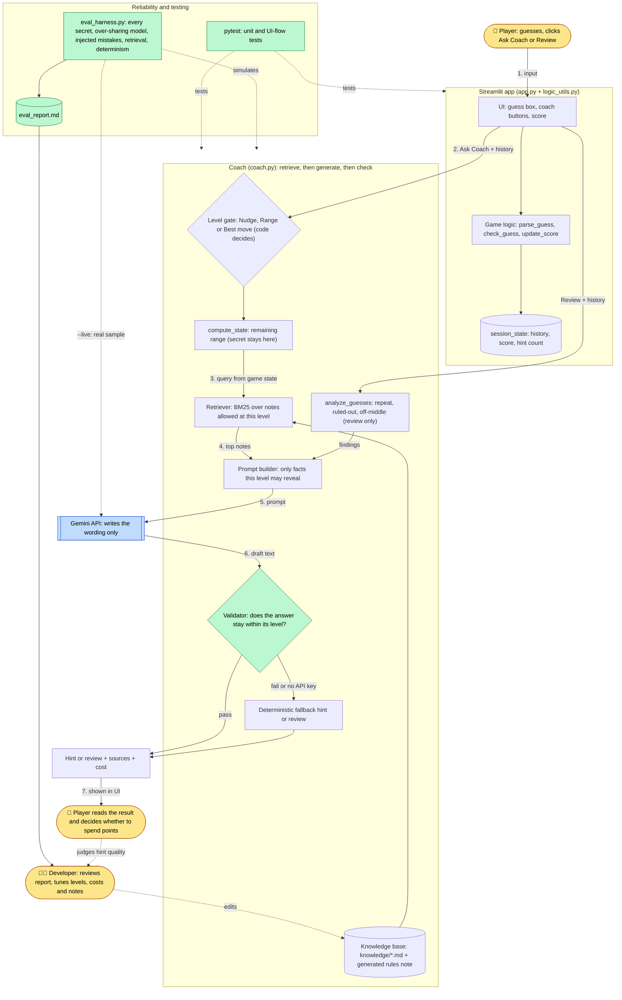

# Guess Number with the COACH

## Original Project (Modules 1-3)

**Original project name:** Game Glitch Investigator

The project was a number guessing game. Players can pick their desired difficulty and try guessing a secret number within a certain number of trial with the help of hints.

## Title and Summary

**What it does:** Users still try guessing numbers within a certain number of trials while the hint is provided by AI coach and it hints you with more and more information in some cost of final score.

**Why it matters:** Instead of fixed comparison hints, coach can react with more detailed and distinct words based on user's previous answers. Users can feel more entertained with the game and have a better experience.

## Architecture Overview

System diagram source: [diagrams/architecture.mmd](diagrams/architecture.mmd)



The system has three parts: the game, the coach, and the reliability checks.

**Game (`app.py`, `logic_utils.py`).** The Streamlit UI takes the player's guess. `logic_utils.py` validates it, compares it to the secret and updates the score. The guess history, score and number of hints used live in `session_state`.

**Coach (`coach.py`).** This is a retrieve → generate → check pipeline, and it runs in two modes:
1. *Hints.* When the player clicks **Ask Coach**, code decides the hint level (Nudge, then Range, then Best move). `compute_state` works out the numbers still possible from the guess history, and the secret never leaves this step. The retriever (BM25) searches the knowledge base in `knowledge/` for the notes that fit the situation, but only notes allowed at that level. The prompt builder adds only the facts that level may reveal, and Gemini writes the wording.
2. *Review.* When the player clicks **Review my guesses** (or the game ends), `analyze_guesses` finds mistakes in plain code: repeated guesses, guesses already ruled out, and guesses far from the middle. The findings go through the same prompt builder, and Gemini explains them in friendly words.

In both modes a **validator** checks the model's answer, for example that a Nudge has no numbers and a Range hint states exactly the remaining range. If the answer fails, or there is no API key or the call errors, a deterministic fallback is shown instead. The UI always shows the notes used, whether the text was AI-written or the fallback, and the point cost.

**Checks.** `pytest` tests the logic, the coach and the UI flow. `eval_harness.py` plays every possible secret on every difficulty, injects mistakes, feeds the coach an over-sharing fake model, scores retrieval, and writes `eval_report.md`. With `--live N` it also samples real Gemini answers.

**Where humans are involved.** The player decides when to ask for a hint and whether it is worth the points, and is the judge of whether the hints are useful. The developer reads `eval_report.md`, and tunes the hint levels, costs and knowledge notes.

## Setup Instructions

Tested with Python 3.13.

1. **Open the project folder** in a terminal:
   ```
   cd applied-ai-system-final
   ```
2. **Install dependencies** (a virtual environment is optional but recommended):
   ```
   python -m venv .venv && source .venv/bin/activate
   pip install -r requirements.txt
   ```
3. **Set your Gemini API key** as an environment variable. Get a key from Google AI Studio, and never put it in a file or commit it:
   ```
   export GEMINI_API_KEY="your-key-here"
   ```
   This step is optional. Without a key the app still works, and the coach uses its built-in fallback hints (the UI says so). To use a different model, set `GEMINI_MODEL` (default: `gemini-3.5-flash-lite`).
4. **Run the app:**
   ```
   python -m streamlit run app.py
   ```
5. **Run the tests and the evaluation harness** (neither needs a key):
   ```
   pytest
   python demo.py                    # reproduces sample interactions 1-3
   python eval_harness.py            # writes eval_report.md
   python eval_harness.py --live 6   # optional: samples 6 real Gemini hints (uses your API quota)
   ```

## Sample Interactions

Examples 1-3 are the real output of `python demo.py`, which runs the real coach code with the model switched off, so the wording is the built-in fallback and the result is identical on every run (the same output is saved in [assets/demo_output.txt](assets/demo_output.txt)). With a Gemini key the app writes the hints in the model's own words, and the validator enforces the same rules. Example 4 is a real run with Gemini.

### Example 1: The hint ladder
Three clicks on **Ask Coach** give a stronger hint each time. Costs are taken from the score, and the button is disabled after the third hint. The ladder starts again after the player's next valid guess.

```
INPUT   Normal (1-100), secret 37. Guesses so far: 50 (too high). Ask Coach x3
OUTPUT  Hint 1/3 · Nudge: Your last guess was too high, so every larger number is ruled out. Where does the possible range end now?
        Based on: narrowing_range, learning_from_feedback · built-in fallback · cost: free
OUTPUT  Hint 2/3 · Range: The secret is between 1 and 49 (inclusive).
        Based on: narrowing_range, binary_search, learning_from_feedback · built-in fallback · cost: -5 pts
OUTPUT  Hint 3/3 · Best move: The secret is between 1 and 49. Guessing the middle, 25, removes half of the possibilities.
        Suggested guess: 25
        Based on: narrowing_range, binary_search, learning_from_feedback · built-in fallback · cost: -15 pts
```

### Example 2: Review my guesses
**Review my guesses** is free. It finds repeated guesses, guesses already ruled out, and guesses far from the middle, and it appears automatically when the game ends.

```
INPUT   Guesses: 50, 90, 90, 45. Click 'Review my guesses'
OUTPUT  Guess #2 (90) could not be the secret: you already knew it was between 1 and 49. Guess #3 (90) repeated an earlier guess, which cannot teach you anything new. Guess #4 (45) was far from the middle of 1-49; guessing near 25 would have removed more possibilities.
        Based on: narrowing_range, avoid_repeats, worst_case_guesses
INPUT   Guesses: 50, 25, 37 (win)
OUTPUT  Every guess so far was inside the possible range and reasonably close to the middle. You won in 3 guesses; with perfect binary search the worst case is 7.
```

### Example 3: The guardrail catches an over-sharing answer
A Nudge must not contain numbers. When the (simulated) model drafts one that does, the validator rejects it and the player sees the built-in nudge, with the reason shown under the hint. This case is also covered in `tests/test_coach.py`.

```
INPUT   Guesses so far: 50. Ask Coach (Nudge). Model drafts: 'Think about bounds, maybe 25.'
OUTPUT  Hint 1/3 · Nudge: Your last guess was too high, so every larger number is ruled out. Where does the possible range end now?
        Based on: narrowing_range, learning_from_feedback · built-in fallback · cost: free
        Reason AI answer not used: nudge must not contain numbers
```

### Example 4: A real Gemini-written hint
A live game with `GEMINI_API_KEY` set. The player's guesses 23, 33 and 83 were too low and 93 was too high, which leaves 84 to 92 possible. The text below was written by Gemini (copied from the app).

```
INPUT   Normal (1-100), secret 84. Guesses so far: 23, 33, 83 (too low), 93 (too high). Ask Coach x3
OUTPUT  Hint 1/3 · Nudge: Since your last guess was too high, think about what that rules out. What numbers are now bigger than the secret?
        Based on: narrowing_range, learning_from_feedback · AI-written · cost: free
OUTPUT  Hint 2/3 · Range: The numbers still possible are anywhere from 84 to 92.
        Based on: narrowing_range, binary_search, learning_from_feedback · AI-written · cost: -5 pts
OUTPUT  Hint 3/3 · Best move: We know the secret is at least 84 and at most 92 based on our previous guesses. Let's use the binary search strategy and pick the middle number of this remaining range.
        Suggested guess: 88
        Based on: narrowing_range, binary_search, learning_from_feedback · AI-written · cost: -15 pts
INPUT   Guess 88: too high (84 to 87 left). Guess 84: correct. A win in 6 of the 8 attempts.
```

Each hint stays within its level's rules, which the validator enforces: the Nudge has no numbers, the Range hint states exactly the remaining range (84 to 92), and the Best move suggests one number inside that range (88, the middle).

**What "Based on" means:** it lists the knowledge-base notes the coach retrieved for this situation and gave to the model, so you can see what each hint was grounded in. The retrieved notes change with the game situation (this is real output of the retriever, with all notes available as at the Best move level):

| Situation | Notes retrieved |
|---|---|
| Start of the game, no guesses yet | first_guess, binary_search, scoring |
| Mid-game after 4 guesses (the Example 4 run) | narrowing_range, binary_search, learning_from_feedback |
| Only 2 attempts left | few_attempts_left, small_range, narrowing_range |
| Three or fewer numbers left | narrowing_range, binary_search, small_range |
| Player repeated a guess | avoid_repeats, narrowing_range, binary_search |


## Design Decisions

- **The game is solved, so the coach had to do more than give the best move.** The optimal guess is always the middle, and a coach that only said that would repeat itself. So the coach reviews the player's own guesses and sells hints in steps. *Trade-off:* more code and more UI than a single hint button.
- **RAG over a small hand-written knowledge base, with BM25 instead of embeddings.** A dozen short notes are easy to read, edit and test, and need no extra service or cost. *Trade-off:* keyword search can miss paraphrases, and my first version retrieved the wrong note for mid-game states (80% on the labelled cases) until I weighted the situation-specific terms.
- **Code decides what the model may say, not the prompt.** The code chooses the hint level, the prompt for each level contains only the facts that level may reveal, and only notes tagged for that level can be retrieved. A model can't leak what it never sees, and an instruction like "don't give the number" alone is unreliable. The secret is never put in a prompt. *Trade-off:* the three levels and their costs are hard-coded rules, though the wording is not.
- **A validator and a deterministic fallback.** Every model answer is checked (for example, a Nudge may not contain numbers), and anything that fails, or any API error, is replaced by a built-in hint. The app and all tests work with no API key. *Trade-off:* fallback hints are plainer and repeat themselves.
- **Mistakes are found by plain code, and the model only explains them.** This makes the review testable: the harness checks that perfect players are never flagged and that injected mistakes are caught. *Trade-off:* it only knows three kinds of mistake, and the "far from the middle" cutoff (1.5 times the ideal) is my judgment call.
- **Hints cost points.** Nudge is free, Range costs 5 and Best move costs 15, so asking becomes a decision. *Trade-off:* the score can go negative, and the numbers are untuned.
- **Gemini, a small model, short outputs, a 15-second timeout.** This keeps cost low and stops the UI from hanging. *Trade-off:* less rich wording.
- **The "Developer Debug Info" panel still shows the secret.** I left it for development, so the coach is only as secret-safe as the player's willingness not to open it.

## Testing Summary

**Summary:** 77 of 77 automated tests passed, and the evaluation harness measured 100% wins in simulated games, 100% retrieval hits on labelled cases, and 0 level-rule violations. The weak spots it found early (retrieval at 80%, a stale button) were fixed after adding the situation weighting and the pre-render check. Full numbers are in [eval_report.md](eval_report.md) (run `python eval_harness.py` to regenerate it).

**Reproducible command output** (full logs: [assets/test_output.txt](assets/test_output.txt), [assets/eval_harness_output.txt](assets/eval_harness_output.txt), [assets/demo_output.txt](assets/demo_output.txt)):

```
$ python -m pytest -q
77 passed

$ python eval_harness.py
| Difficulty | Games | Win rate | Avg guesses | Max guesses | Invalid suggestions |
| Easy       | 20    | 100%     | 3.70        | 5           | 0                   |
| Normal     | 100   | 100%     | 5.80        | 7           | 0                   |
| Hard       | 50    | 100%     | 4.86        | 6           | 0                   |
Determinism: 0 mismatches across repeated runs
Retrieval hit rate: 100%
Perfect binary-search players flagged: 0 of 170 games (target 0)
Injected mistakes detected: 966 of 966
Fallback hints that obey their level's rules: 297 of 297
Over-sharing model answers blocked at levels 1-2: 198 of 198

$ python eval_harness.py --live 10     (with a real GEMINI_API_KEY)
10/10 hints were AI-written and passed the guardrail; 0 fell back to the deterministic hint.
```

**How reliability is checked:** automated tests (`pytest`), a measurement harness (`eval_harness.py`), and error handling that records what failed and why. Every time a model answer is rejected or the API call fails, the coach swaps in a fallback hint and keeps the reason, which the app shows under the hint (for example "AI unavailable: nudge must not contain numbers"). The optional `--live` run also checks real Gemini answers against the same validator.

- **What worked:**
  - **Simulated games:** following the coach's suggested guess won 100% of games on every difficulty, covering every possible secret (Easy 3.70 average guesses, Normal 5.80, Hard 4.86), with 0 invalid suggestions.
  - **Determinism:** the same game state gave the same hint every time.
  - **Retrieval:** the right note was in the top 3 for all 5 labelled situations (100%).
  - **Mistake detection:** perfect players were never flagged (0 of 170 games), and all 966 injected mistakes were caught.
  - **Level gating:** all 297 fallback hints obeyed their level's rules, and all 198 over-sharing model answers at levels 1-2 were blocked.
  - **No API key needed:** the whole suite runs offline, because the model call is injectable.
  - **Live Gemini sample:** `python eval_harness.py --live 10` tried 10 real hints at random levels (1-3). All 10 were AI-written and passed the validator, and none fell back to the deterministic hint. This is a small sample, so it shows the prompts work, not that the model never breaks the rules.
- **What didn't (caught during development, then fixed):**
  - The harness first scored retrieval at 80%, because mid-game states missed the "narrowing the range" note. Weighting the situation-specific query terms fixed it.
  - A UI test showed the Ask Coach button stayed enabled on the guess that ended the game, because it was drawn before the guess was scored. The app now checks this before drawing the button.
- **What you learned:** The most reliable way to control an AI is to control what it sees and to check what it says, not to ask it nicely in a prompt. Because the model never receives the secret and every answer goes through a validator, it can't leak the number, and I can prove that with tests. Testing also surfaced problems I would not have spotted by playing the game, like the button that stayed enabled after the game ended and the retrieval gap at 80%. And a good fallback means a flaky API never breaks the game.

## Reflection

This project taught me that adding AI to a simple game is mostly a problem-solving task, not a prompting task. My first coach just said "guess the middle" every time, so I had to rethink what the AI was for: reviewing the player's own guesses and giving stronger hints for a price. I also learned to design around what the model can and cannot be trusted with. It never sees the secret, code decides how much each hint may reveal, and a validator plus a fallback means a wrong or missing answer cannot break the game. Finally, measuring beat guessing: the harness and tests found problems I would not have noticed by playing, like weak retrieval and a button that stayed enabled after the game ended. The honest limits are in [model_card.md](model_card.md).

